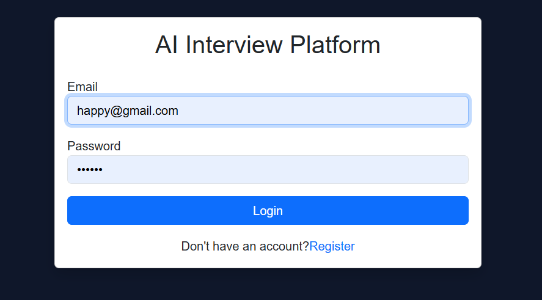
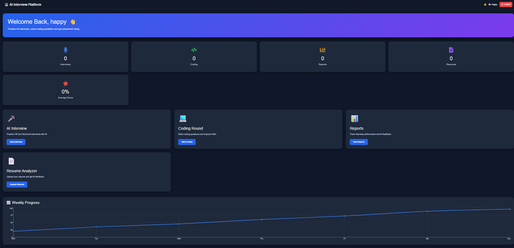
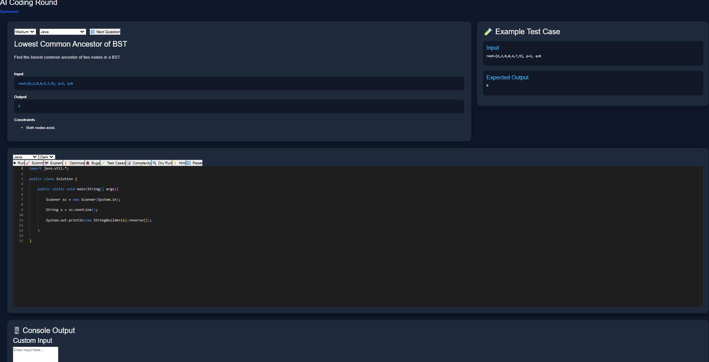
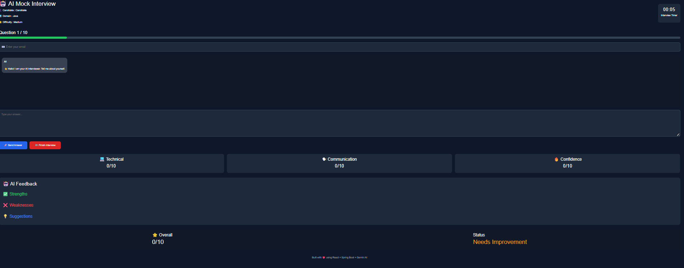
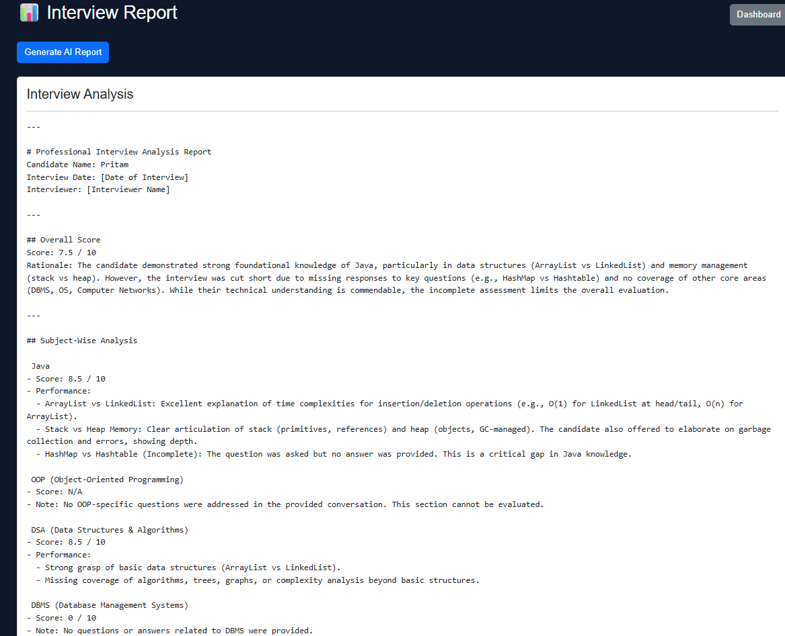
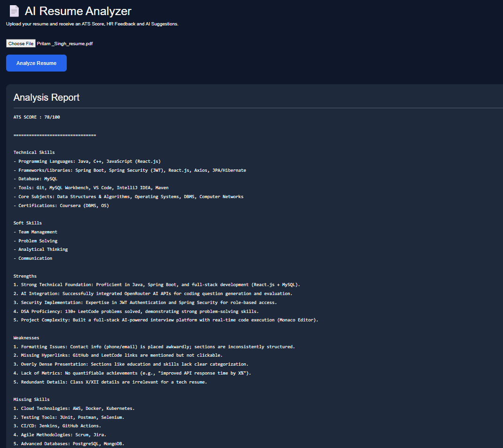

<div align="center">

# 🎯 AI Interview Platform

**Full-stack AI-powered interview preparation — code, interview, and get hired.**

[](https://react.dev/)
[](https://vitejs.dev/)
[](https://spring.io/projects/spring-boot)
[](https://www.oracle.com/java/)
[](LICENSE)

</div>

---

## 📖 Overview

AI Interview Platform is a complete interview-preparation suite where you can **solve coding problems in an online IDE**, **have a live conversation with an AI interviewer**, **analyze your resume**, and **track your progress** — all in one place.

| | |
|---|---|
| 💻 **Coding IDE** | Monaco-powered editor, run & submit against test cases, instant evaluation |
| 🎤 **AI Mock Interview** | Conversational technical interview with AI, scored feedback & report |
| 📄 **Resume Analyzer** | Upload a PDF resume and get AI-powered improvement suggestions |
| 📊 **Dashboard** | Stats, streaks, progress charts, recent activity at a glance |
| 📜 **Interview Reports** | Every attempt scored and stored — review anytime |

---

## 📸 Screenshots

| Login | Dashboard |
|:---:|:---:|
|  |  |

| Coding IDE | AI Interview |
|:---:|:---:|
|  |  |

| Interview Report | Resume Analyzer |
|:---:|:---:|
|  |  |

---

## ✨ Features

### 🔐 Authentication
- Register / Login with **JWT-based** stateless auth
- Password encryption with BCrypt via Spring Security
- Protected routes on the frontend — redirect to login if unauthenticated

### 💻 Coding IDE
- **Monaco Editor** with syntax highlighting and autocomplete
- **Run** code against sample test cases or **Submit** for full evaluation
- Server-side code compilation & execution (Java, and more)
- Problem statement, examples, and constraints panel
- Submission history with per-question attempt tracking

### 🎤 AI Mock Interview
- Chat-based technical interview powered by **OpenRouter LLM**
- Interviewer asks follow-up questions, probes deeper, and adapts
- Automatic evaluation with a structured score + written feedback
- Generates a shareable **interview report**

### 📄 Resume Analyzer
- Upload a **PDF** resume (parsed with Apache PDFBox)
- AI extracts skills, experience, and strengths
- Actionable improvement suggestions

### 📊 Dashboard
- Total interviews, coding submissions, average scores
- Activity charts (**Recharts**), streak tracking, recent submissions

### 🗂️ Question Bank
- **150 coding questions** with difficulty levels and categories
- Filter by category / difficulty via REST API

---

## 🏗️ Tech Stack

```
┌─────────────────────────────────────────────────────────┐
│  FRONTEND                          BACKEND              │
│  React 19 + Vite 8                 Spring Boot 3.5     │
│  React Router 7                    Java 17             │
│  Monaco Editor                     Spring Security     │
│  Axios                             JPA + H2 / MySQL    │
│  Recharts                          JWT (jjwt)          │
│  Framer Motion                     Apache PDFBox       │
│  Bootstrap 5 + custom CSS          Lombok              │
│                                    OpenRouter LLM API  │
└─────────────────────────────────────────────────────────┘
```

| Layer | Technology |
|-------|-----------|
| **Frontend** | React 19, Vite 8, React Router 7, Axios |
| **Editor** | `@monaco-editor/react` |
| **Styling** | Bootstrap 5, custom CSS, Framer Motion |
| **Charts** | Recharts |
| **Backend** | Spring Boot 3.5 (Web, Data JPA, Security, Validation) |
| **Database** | H2 (in-memory for dev), MySQL-ready for production |
| **Auth** | JWT tokens, BCrypt password hashing |
| **AI** | OpenRouter API (LLM) for interview, code review, resume analysis |
| **PDF** | Apache PDFBox |

---

## 📁 Project Structure

```
AI-Interview-Platform-Full/
│
├── frontend/                          # React client
│   ├── public/
│   ├── src/
│   │   ├── components/                # Reusable UI
│   │   │   ├── EditorPanel.jsx        #   Monaco code editor
│   │   │   ├── ConsolePanel.jsx       #   Run output panel
│   │   │   ├── TestCasePanel.jsx      #   Test-case results
│   │   │   ├── ProblemPanel.jsx       #   Problem statement
│   │   │   ├── FeedbackPanel.jsx      #   Interview feedback
│   │   │   ├── Navbar.jsx
│   │   │   ├── ProtectedRoute.jsx     #   Auth guard
│   │   │   └── …
│   │   ├── pages/                     # Route-level screens
│   │   │   ├── Login.jsx / Register.jsx
│   │   │   ├── Dashboard.jsx
│   │   │   ├── Coding.jsx             #   Coding IDE
│   │   │   ├── CodingHistory.jsx
│   │   │   ├── InterviewSetup.jsx / Interview.jsx
│   │   │   ├── Report.jsx
│   │   │   └── ResumeAnalyzer.jsx
│   │   ├── data/questions.js          # Question bank (150 problems)
│   │   ├── services/api.js            # Axios instance + interceptors
│   │   ├── styles/                    # Page CSS
│   │   ├── App.jsx                    # Routes
│   │   └── main.jsx
│   ├── package.json
│   └── vite.config.js
│
├── backend/                           # Spring Boot API
│   ├── src/main/java/com/aiml/interviewplatform/
│   │   ├── controller/                # REST endpoints
│   │   ├── service/                   # Business logic
│   │   ├── repository/                # JPA repositories
│   │   ├── entity/                    # JPA entities
│   │   ├── dto/                       # Request / response DTOs
│   │   ├── security/                  # JWT filter, UserDetails
│   │   ├── config/                    # CORS, app config
│   │   └── exception/                 # Global exception handler
│   ├── src/main/resources/
│   │   └── application.properties
│   └── pom.xml
│
├── docs/                              # Screenshots
└── README.md
```

---

## 🚀 Quick Start

### Prerequisites

| Tool | Version |
|------|---------|
| **Node.js** | 18+ (20+ recommended) |
| **Java JDK** | 17+ |
| **Maven** | 3.8+ (or use the bundled `mvnw`) |

### 1️⃣ Start the Backend (port `8080`)

```bash
cd backend
./mvnw spring-boot:run        # Windows: mvnw.cmd spring-boot:run
```

> **Windows:** `mvnw.cmd spring-boot:run`

The API is live at **http://localhost:8080**
H2 console at **http://localhost:8080/h2-console** (JDBC URL: `jdbc:h2:mem:interviewdb`, user: `sa`)

### 2️⃣ Start the Frontend (port `5173`)

```bash
cd frontend
npm install
npm run dev
```

Open **http://localhost:5173** → you'll be redirected to the login page.

### 3️⃣ Create an account

Go to **/register**, create an account, and log in. You're in! 🎉

---

## ⚙️ Environment Variables

### Backend — `backend/src/main/resources/application.properties`

| Property | Env Var | Default | Description |
|----------|---------|---------|-------------|
| `jwt.secret` | `JWT_SECRET` | dev fallback | Secret key for signing JWTs (**change in production**) |
| `jwt.expiration` | — | `604800000` (7 days) | Token lifetime in ms |
| `openrouter.api.key` | `OPENROUTER_API_KEY` | placeholder | **Your** [OpenRouter](https://openrouter.ai) API key for AI features |
| `spring.datasource.url` | — | `jdbc:h2:mem:interviewdb` | Swap to `jdbc:mysql://…` for production |

```bash
# Example (PowerShell)
$env:OPENROUTER_API_KEY = "sk-or-v1-..."
$env:JWT_SECRET = "a-very-long-random-secret-at-least-32-chars"
```

### Frontend — `frontend/.env` (optional)

| Variable | Default | Description |
|----------|---------|-------------|
| `VITE_API_BASE_URL` | `http://localhost:8080` | Backend base URL |

> The Axios instance in `src/services/api.js` reads this and attaches the JWT from `localStorage` to every request.

---

## 🔌 API Reference

Base URL: `http://localhost:8080`

### Auth
| Method | Endpoint | Body | Description |
|--------|----------|------|-------------|
| `POST` | `/api/auth/register` | `{ username, email, password }` | Create account |
| `POST` | `/api/auth/login` | `{ email, password }` | Get JWT token |

### Coding
| Method | Endpoint | Description |
|--------|----------|-------------|
| `GET` | `/api/questions` | All questions |
| `GET` | `/api/questions/{id}` | Single question |
| `GET` | `/api/questions/category/{category}` | Filter by category |
| `GET` | `/api/questions/difficulty/{level}` | Filter by difficulty |
| `POST` | `/api/compiler/run` | Compile & run against sample cases |
| `POST` | `/api/submission` | Submit for full evaluation |
| `GET` | `/api/coding/attempts` | Submission history |

### AI (OpenRouter)
| Method | Endpoint | Description |
|--------|----------|-------------|
| `POST` | `/api/gemini/explain` | Explain a concept |
| `POST` | `/api/gemini/code` | Generate code |
| `POST` | `/api/gemini/review` | Review code |
| `POST` | `/api/gemini/hint` | Get a hint (no spoilers) |
| `POST` | `/api/gemini/optimize` | Optimize code |
| `POST` | `/api/gemini/bugs` | Find bugs |
| `POST` | `/api/gemini/complexity` | Analyze time/space complexity |

### Interview
| Method | Endpoint | Description |
|--------|----------|-------------|
| `POST` | `/api/interview/chat` | Send message, get interviewer reply |
| `POST` | `/api/interview/evaluate` | Score the interview |
| `POST` | `/api/reports/generate` | Generate interview report |
| `GET`  | `/api/reports/{id}` | Fetch a report |
| `GET`  | `/api/attempts/my` | My interview attempts |

### Resume & Dashboard
| Method | Endpoint | Description |
|--------|----------|-------------|
| `POST` | `/api/resume/analyze` | Upload PDF → AI analysis (`multipart/form-data`) |
| `GET`  | `/api/dashboard/stats` | Stats for the dashboard |

> 🔒 Endpoints except `/api/auth/*` require `Authorization: Bearer <token>`.

---

## 🗺️ Frontend Routes

| Route | Page | Auth |
|-------|------|------|
| `/` | Login | Public |
| `/register` | Register | Public |
| `/dashboard` | Dashboard | ✅ |
| `/coding` | Coding IDE | ✅ |
| `/coding-history` | Submission history | ✅ |
| `/interview-setup` | Configure interview | ✅ |
| `/interview` | Live AI interview | ✅ |
| `/report` | Interview reports | ✅ |
| `/resume` | Resume analyzer | ✅ |
| `*` | → redirects to `/` | — |

---

## 🧪 Useful Scripts

```bash
# Frontend
npm run dev        # Start dev server with HMR
npm run build      # Production build → dist/
npm run lint       # ESLint
npm run preview    # Preview the production build

# Backend
mvnw spring-boot:run                    # Run dev server
mvnw test                               # Run tests
mvnw package                            # Build jar → target/
java -jar target/interviewplatform-*.jar  # Run the built jar
```

---

## 🛡️ Security Notes

- **JWT** — stateless auth; tokens are sent via `Authorization` header
- **BCrypt** — password hashing
- **CORS** — configured to allow the Vite dev origin
- **Validation** — `@Valid` on all request DTOs
- **Global exception handler** — no stack traces leaked to clients
- ⚠️ **Production checklist**: set strong `JWT_SECRET` and `OPENROUTER_API_KEY` via environment variables, switch H2 → MySQL/PostgreSQL, and serve over HTTPS

---

## 📄 License

MIT © [pritamcodinghere-hash](https://github.com/pritamcodinghere-hash)

---

<div align="center">

**Built with ❤️ to help developers crack their dream interviews**

⭐ Star this repo if it helped you!

</div>
